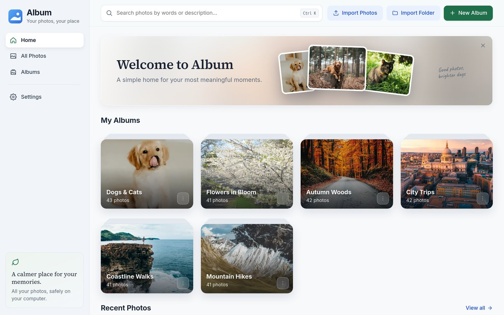
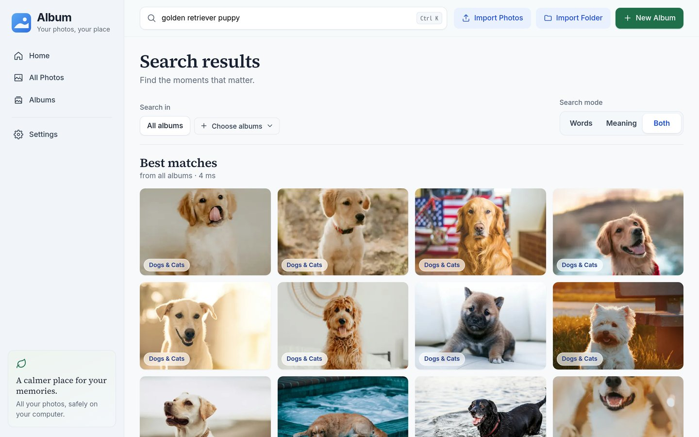

# Semantic Album

A local-first photo library that understands what is in your photos. It keeps your library on your own computer, writes a description and tags for every photo, and lets you find photos by the words in those descriptions or by what the photo shows.



## What it does

- **Imports** selected files or a whole folder. A folder becomes an album named after it. The app keeps its own copy of each photo, so the source folder can be moved or deleted afterwards.
- **Stores each photo once.** Identical bytes are recognised by SHA-256; one stored photo can belong to several albums.
- **Reads common formats** (JPEG, PNG, WebP, GIF, BMP, TIFF, HEIC/HEIF, AVIF), identified by content rather than file extension. A file that cannot be decoded is reported and does not stop the import.
- **Describes every photo.** A cloud vision model (DeepSeek, with OpenAI as fallback) writes a description, tags and a list of visible objects. You can edit the text; a later AI run never replaces your edit.
- **Searches** by **Words** (full-text index), **Meaning** (image and text vectors from a local multimodal model), or **Both**, across one album, several, or all of them.
- **Exports** an album or a selection as a ZIP with the original photos, JSON and CSV metadata, and an XMP sidecar per photo.
- **Keeps working through restarts.** Imports and background processing resume where they stopped, with live progress and throughput for each stage.
- **Says where data goes.** The settings page lists, for the current configuration, which service receives what.



## How it works

```text
Browser (React + TypeScript)
   │  REST/JSON and multipart uploads
   ▼
Local API (Node + Fastify) ── SQLite (albums, photos, descriptions, tasks, search index)
   │                       └─ app-owned originals, display copies, thumbnails
   ├── vLLM on the local GPU: Qwen3-VL-Embedding-2B (2048-dim vectors)
   ├── cloud vision: DeepSeek (primary), OpenAI (fallback)        ← photo
   ├── n8n workflow in Docker: tidy text, write/read a Data Table  ← text only
   └── Baserow in Docker: text copy of albums, photos and tags    ← text only
```

The SQLite database and the photo files are the source of truth. n8n and Baserow are optional, self-hosted, and only ever receive text; if they are down, the app keeps working and catches up later. Without the GPU model, Meaning and Both searches fall back to Words.

The module structure of the backend is described in [docs/architecture.md](docs/architecture.md).

## Privacy

- Original photos, copies, thumbnails, the database and the search index stay on your computer.
- With descriptions turned on, each photo is sent once to DeepSeek; OpenAI receives a photo only when DeepSeek cannot describe it.
- n8n and Baserow receive description text and tags, never photos.
- There is no account, analytics, or cloud photo storage.

## Running it

Requirements: Node.js 22.12+, pnpm 10, and Docker for n8n and Baserow. HEIC and BMP need `heif-dec` (libheif), `ffmpeg`, or ImageMagick. Meaning search needs an NVIDIA GPU with 8 GB or more.

```bash
cd Album
cp .env.example .env      # then add your DeepSeek (and optionally OpenAI) API key
./start.sh                # installs dependencies on first run; starts vLLM, the API and the web app
./stop.sh
```

- App: <http://127.0.0.1:5173>
- API health: <http://127.0.0.1:3200/api/health>

**Meaning search (optional).** Install vLLM into `.venv` at the repository root and download the model into `models/Qwen3-VL-Embedding-2B` (about 12 GB in total):

```bash
uv venv .venv --python 3.12
uv pip install --python .venv/bin/python vllm==0.30.0
```

Set `VLLM_ENABLED=false` in `Album/.env` to run without it.

**n8n and Baserow (optional).** See [n8n/README.md](n8n/README.md) and [baserow/README.md](baserow/README.md). In short: run `docker compose up -d` in `n8n/`, create an API key, and `node n8n/deploy.mjs` deploys the workflow and connects it to the app; run `docker compose up -d --build` in `baserow/`, then put the table ids and a database token in `Album/.env`.

**API.** Every `/api` request except `/api/health` needs the `X-API-Key` header when `ALBUM_API_KEY` is set; the web app's dev proxy adds it. A Postman collection is in [Album/api](Album/api/README.md).

## Repository layout

| Path | Contents |
| --- | --- |
| `Album/src/` | Backend: ingress, application modules, infrastructure capabilities, data access, SQLite migrations |
| `Album/app/` | Web app |
| `Album/api/` | Postman collection and environment |
| `n8n/`, `baserow/` | Self-hosted low-code services (Docker) |
| `docs/` | Architecture, design notes and the decision log |
| `design/` | UI concept images |
| `apps/`, `automation/` | The earlier prototype, kept for history |

## Status

Working today: everything listed under *What it does*. Planned next:

- Search by example photo.
- Very tall or wide images, such as scrolling phone screenshots, cut into overlapping pieces before they are described.
- A retry with DeepSeek before falling back to OpenAI.
- A full accessibility pass: keyboard use, screen-reader labels, colour contrast.

Photos in the screenshots are from [Unsplash](https://unsplash.com).
